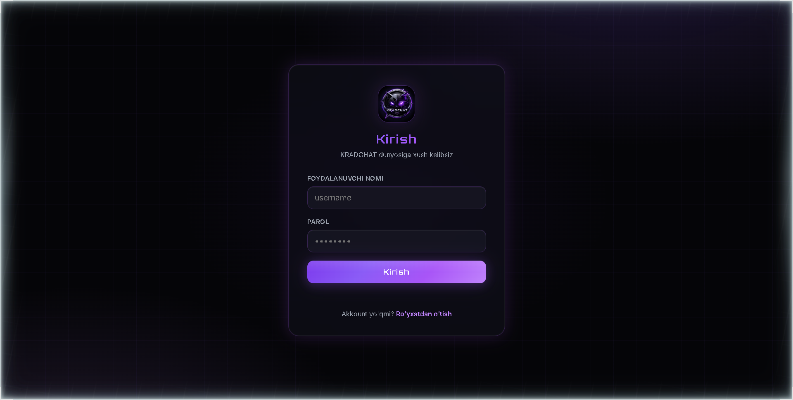
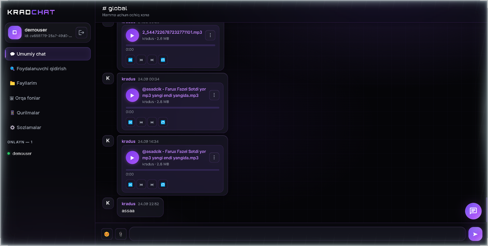

# KRADCHAT — Talk to the Future

Xavfsiz, real-time chat: Go backend + WebAssembly frontend, bitta binary'da.




## Xususiyatlar

- Real-time xabarlar (WebSocket), umumiy xona + shaxsiy DM
- Fayl almashish (chunked upload, 50MB), rasm/video/audio preview, Telegram-uslub musiqa player (auto-next, shuffle, repeat)
- Avatar, orqa fonlar, emoji, javoblar (reply), mention'lar, bloklash
- 2FA (TOTP, shifrlangan saqlanadi), qurilma boshqaruvi, sessiya revoke
- Xavfsizlik: bcrypt-12, HS256 JWT (32+ belgili secret majburiy), rate-limit, audit loglar, gzip statik

## Tez start (2 daqiqa)

Talab: **Go 1.24+**.

```bash
# 1. Konfig
cp .env.example .env
# .env ichida JWT_SECRET ni kamida 32 belgili tasodifiy qatorga almashtiring:
#   Windows (PowerShell): -join ((48..57+65..90+97..122) | Get-Random -Count 48 | % {[char]$_})
#   Linux: openssl rand -hex 32

# 2. Build (bitta buyruq)
# Windows:
powershell -NoProfile -ExecutionPolicy Bypass -File build.ps1 -Release
# Linux/macOS:
./build.sh

# 3. Ishga tushirish
./kradchat        # Windows: .\kradchat.exe
# → http://localhost:8080
```

Birinchi ro'yxatdan o'tgan foydalanuvchi oddiy user'dir; `VERIFIED_USERS` (`.env`) ga username qo'shsangiz ✓ belgisi beriladi.

## Konfiguratsiya (asosiylari)

| O'zgaruvchi | Default | Izoh |
|---|---|---|
| `SERVER_PORT` | `8080` | HTTP+WS porti |
| `DB_DRIVER` | `postgres` | `postgres`/`mysql`/`mariadb`/`sqlite` |
| `DB_PASSWORD` | `kradchat` | Production'da almashtiring |
| `JWT_SECRET` | — | **Majburiy, min 32 belgi**, bo'lmasa server ishga tushmaydi |
| `JWT_ACCESS_EXPIRE` | `15m` | Access token yashashi |
| `JWT_REFRESH_EXPIRE` | `168h` | Refresh token yashashi |
| `MAX_FILE_SIZE` | `52428800` | 50MB |
| `BCRYPT_COST` | `12` | 10–15 oralig'ida |
| `STATIC_DIR` / `UPLOAD_DIR` | `./web/static`... | Statik/fayl papkalari |

SQLite bilan eng oson rejim: `DB_DRIVER=sqlite`, `DB_PATH=./kradchat.db` (migratsiya avtomatik).

## Loyiha tuzilishi

```
cmd/server        → main (composition root, lifecycle)
internal/config   → env konfig + validatsiya
internal/database → ulanish + migratsiyalar
internal/repository → SQL (postgres/mysql/sqlite dialektlari)
internal/service  → biznes logika (auth, chat, upload, 2FA, presence, blocks)
internal/handler  → HTTP + WS handler'lar, router
internal/ws       → hub, room, client, protokol
internal/security → validatsiya, sanitizer, rate-limiter, dedup
internal/middleware → auth, CORS/origin, gzip, log, rate-limit
internal/model    → domain modellar
internal/emoji    → emoji katalogi
web/src           → Go/WASM frontend (chat, auth, upload, viewer...)
web/static        → style.css, logo, fonlar, uploads/
web/wasm          → boot.js (loader) + build'da generatsiya: app.wasm
```

## Testlar

```bash
gofmt -l internal cmd web/src   # toza bo'lishi kerak
go vet ./...
go test -count=1 ./...
```

## Muammolar va yechimlar (troubleshooting)

| Alomat | Sabab | Yechim |
|---|---|---|
| `WASM yuklab bo'lmadi` / loader 0% da qoladi | `/wasm/app.wasm` topilmadi yoki eski kesh | `build.ps1 -Release` / `./build.sh` qayta; brauzerda **Ctrl+F5** |
| Yangi frontend ko'rinmayapti | Brauzer keshi | Ctrl+F5 (style.css `no-cache`, wasm `?v=` bilan) |
| `JWT secret ...` xato bilan start bo'lmaydi | Secret < 32 belgi yoki default | `.env` da 32+ belgili tasodifiy `JWT_SECRET` |
| `address already in use` (8080 band) | Eski server ishlayapti | Eski `kradchat.exe` ni to'xtating (`taskkill /PID ... /F`), qayta ishga tushiring |
| `SQLITE_BUSY` / `database is locked` | Parallel yozuv bosimi | Odatda o'z-o'zidan o'tadi; takrorlansa `DB_MAX_CONNS` ni kamaytiring |
| Login'da `rate_limited` (429) | 10/min per-akkaunt limit | 1 daqiqa kuting (brute-force himoyasi) |
| `2fa_locked` (429) | 5 noto'g'ri kod (pending) yoki 20/15min (akkaunt) | Qayta login qiling; 15 daqiqa kuting |
| Fayl yuklanmayapti (413) | 50MB dan katta yoki rasm o'lchami katta (12000px/50MP) | Faylni kichraytiring |
| Fayl yuklanmayapti (429 `too_many_uploads`) | 5+ parallel upload | Bittasini tugatib qayta urining |
| `too_many_devices` (429) | 10 aktiv qurilma | Sozlamalar → Qurilmalar'dan eskisini o'chiring |
| WS ulanmayapti (`origin not allowed`) | CORS/Origin | LAN'da kirsangiz ham host bir xil bo'lishi kerak; reverse-proxy'da `Host` ni forward qiling |
| Mobil'da ☰ ishlamaydi / drawer ochilmaydi | Eski wasm keshda | Ctrl+F5; keyin ☰ chat-header ichida |
| Mobil'da input fokusda zoom bo'ladi | Eski CSS keshda | Ctrl+F5 (inputlar 16px qilingan) |
| `room access denied` (DM) | DM nomi validatsiya'dan o'tmadi | DM xonalar faqat ilova ichidan ochiladi |
| Tungi `server stopped` (Windows) | Konsol yopilganda process o'ladi | NSSM / Scheduled Task bilan servis qiling (pastga qarang) |
| `/wasm/*.bak` 404 | Ataylab o'chirilgan | Build chiqindilari public bo'lmaydi — normal holat |
| `C:\downloads` ga yozilmayapti | Mirror lock | Rename-move pattern: `.new` ga ko'chirib `move /y` qiling |

### Windows'da servis qilish (NSSM)

```powershell
nssm install kradchat C:\kradchat\kradchat.exe
nssm set kradchat AppDirectory C:\kradchat
nssm set kradchat AppStdout C:\kradchat\server.out.log
nssm set kradchat AppStderr C:\kradchat\server.err.log
nssm start kradchat
```

### Xavfsizlik eslatmalari

- `.env` ni hech qachon commit qilmang (faqat `.env.example` repo'da).
- Production'da `JWT_SECRET`, `DB_PASSWORD` ni almashtiring; HTTPS (reverse-proxy: Caddy/Nginx) ortida ishlating.
- TOTP secret'lar AES-256-GCM bilan saqlanadi (kalit = JWT secret). **JWT secret'ni almashtirsangiz 2FA qayta sozlanishi kerak.**
- Logout/parol almashtirilgach access-JWT ~15 daqiqa texnik yashashi mumkin (WS darhol uziladi).

## English (short)

Secure real-time chat in a single Go binary (backend + WASM frontend). Quick start: copy `.env.example` to `.env`, set a 32+ char `JWT_SECRET`, run `build.ps1 -Release` (Windows) or `./build.sh` (Linux), then `./kradchat` → http://localhost:8080. See the table above for troubleshooting.

## Litsenziya

MIT — `LICENSE` ga qarang.
